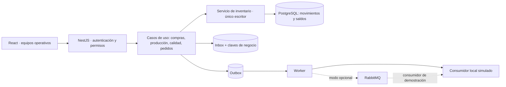

# Arquitectura implementada

## 1. Monolito modular centrado en inventarios

La aplicación web React se comunica con un backend NestJS por HTTP/JSON. El backend contiene servicios de autenticación, casos de uso, inventario y mensajería. Las divisiones funcionales del menú no son aplicaciones ni microservicios independientes. Comparten una base PostgreSQL y transacciones locales.

En esta versión inicial los casos de uso de los módulos se organizan por acciones dentro de `Commands`; el núcleo de saldos está separado en `InventoryService`. Es una división lógica funcional, no nueve módulos NestJS desplegables. La siguiente refactorización puede separar cada grupo de comandos sin modificar las reglas del inventario.

Las escrituras de Inbox, efectos de negocio, saldos, movimientos, documento, auditoría y Outbox se confirman en la **misma transacción**. El worker actúa después del commit.

## 2. Actualización interna

Ejemplo: confirmar salida de un pedido reservado.

1. El servidor verifica identidad y permiso `despacho`.
2. Valida que la versión del pedido sea la esperada y su estado sea `RESERVADO`.
3. Verifica que los lotes sigan liberados y no vencidos.
4. Consume las reservas, reduce el físico y crea movimientos de despacho.
5. Cambia el estado del pedido, registra auditoría y crea un mensaje Outbox.
6. Confirma toda la transacción. Si cualquier paso falla, revierte todo.
7. El frontend vuelve a consultar el estado oficial.
8. El worker entrega posteriormente el evento a un consumidor simulado.

Confirmar una entrega posterior no repite el paso 4. Solo agrega evidencia y cambia el estado logístico.

El piloto serializa los comandos de escritura con un bloqueo transaccional asesor de PostgreSQL. Es una elección deliberada de simplicidad para bajo volumen: impide carreras entre reserva, calidad, conteo y despacho. No es una estrategia de escalabilidad ilimitada. En una versión de alta carga se reemplazaría por bloqueos por artículo/almacén con orden consistente y pruebas adicionales.

Las consultas de la pantalla se obtienen dentro de una transacción de lectura `REPEATABLE READ`, para mostrar un conjunto coherente de datos.

## 3. Invariantes

| Regla | Implementación |
|---|---|
| Físico no negativo | `CHECK physical >= 0` y validación antes del movimiento |
| Reserva entre cero y físico | Restricciones SQL y asignación serializada |
| Solo inventario cambia saldos | `InventoryService.move/reserve/release` |
| Calidad no crea ni elimina unidades | Actualiza elegibilidad del lote |
| Historial no reescribible | Triggers que rechazan UPDATE/DELETE en movimientos y auditoría |
| Un conteo no ajusta automáticamente | Registro pendiente y aprobación separada |
| Merma no obligatoria | Movimiento solo cuando la pérdida informada es mayor a cero |
| Datos decimales exactos | `numeric(16,3)` y Decimal.js; máximo tres decimales |
| Tránsito no es ATP actual | No se incluye en existencia elegible del almacén |

La tabla muestra físico, reservado y disponible. La retención por calidad afecta todo el lote, incluidas reservas existentes; por tanto, “retenido” y “reservado” pueden solaparse. No se restan dos veces. Si no es elegible, su disponible es cero.

FEFO ordena por vencimiento, luego ingreso, lote y ubicación. FIFO ordena por ingreso, lote y ubicación. Ambos excluyen lotes retenidos o vencidos. La fecha de vencimiento es obligatoria al crear un lote de artículo FEFO. No se modifica automáticamente una reserva ya confirmada al cambiar la política del artículo.

## 4. Deduplicación en capas

- **Inbox:** unicidad de `(source, event_id)`. Repetir exactamente el mismo mensaje devuelve el resultado previo y aumenta el contador, sin aplicar movimientos.
- **Clave de negocio:** acción más referencia del documento o hecho. Dos eventId distintos para el mismo hecho obtienen el mismo resultado.
- **Huella de contenido:** si se reutiliza una referencia con datos diferentes, el servidor responde conflicto en lugar de adivinar cuál es correcto.
- **Restricciones SQL:** unicidad de claves de efecto, movimiento e Inbox como última barrera de integridad.
- **Versiones:** documentos, lotes, usuarios, políticas y saldos incluyen control de concurrencia. Un estado anterior no puede sobrescribir el actual.
- **Conciliación:** compara físico con suma de movimientos y reservado con reservas activas. Solo señala diferencias.

La referencia debe identificar el hecho real: por ejemplo, el remito o la recepción. Inventar otra referencia para el mismo hecho no puede detectarse automáticamente solo por cantidad y fecha; es necesario respetar el contrato del origen.

Las solicitudes rechazadas se revierten, incluido su Inbox. El contador de Inbox muestra repeticiones de mensajes aceptados; no constituye un registro exhaustivo de todos los errores de autenticación o validación.

## 5. Outbox, worker y colas

**Inbox recibe. Inventario aplica. Outbox notifica lo confirmado.** No son dos caminos que descuentan el mismo inventario.

En el modo predeterminado:

1. El evento se persiste en Outbox junto con el hecho de negocio.
2. Cada dos segundos, el worker toma hasta diez mensajes listos usando `FOR UPDATE SKIP LOCKED`.
3. El consumidor local simulado registra la entrega en `deliveries`.
4. Se marca `ENVIADO` solo al completar esa operación.
5. Si falla el destino, queda pendiente y vuelve a intentar después de tres segundos.
6. Al tercer fallo pasa a `REVISION`; un usuario autorizado puede solicitar un nuevo ciclo.

La simulación de caída no bloquea las operaciones internas del inventario. Los datos están persistidos en PostgreSQL, no en una lista del navegador. El indicador `attempts` es del ciclo actual; la acción manual de reintento queda auditada.

El consumidor posee una clave única `event_id`, de modo que una entrega repetida no se almacena dos veces. La garantía buscada es **entrega al menos una vez con efecto idempotente**, no “la red nunca repite”.

### Modo opcional RabbitMQ

`INTEGRATION_MODE=rabbitmq` y `AMQP_URL` habilitan el adaptador. Publica mensajes persistentes a `cbn.inventory.events`, espera confirmación del broker y el consumidor confirma con ACK después de guardar. Los mensajes que el consumidor no puede procesar se dirigen a `cbn.inventory.review` mediante un exchange de revisión.

En ese modo `ENVIADO` significa confirmado por el broker, no que un sistema real de CBN lo haya procesado. El consumidor sigue siendo una demostración local. Debe probarse con un broker operativo antes de presentarlo como integración RabbitMQ verificada.

## 6. Cohesión y acoplamiento

La cohesión de Inventario se concentra en una sola responsabilidad: mantener cantidades, elegibilidad y trazabilidad de movimientos. Compras no implementa otro algoritmo de saldo y Despacho no ejecuta SQL directo para descontar.

El acoplamiento interno se reduce usando operaciones del servicio de inventario. **No desaparece:** comparten despliegue, base, contratos y disponibilidad del monolito. No hace falta convertir el ERP en microservicios para separar responsabilidades.

La mensajería reduce la dependencia temporal respecto al consumidor externo: su caída no revierte un movimiento ya confirmado. Aun así, productor y consumidor deben acordar identificadores, significado del mensaje y esquema. No se afirma “acoplamiento cero”.

## 7. Reposición, tránsito y promesa

**ROP = demanda diaria × plazo de reposición + stock de seguridad.**

La posición de planificación es disponible elegible más compras aprobadas pendientes de recepción. Incluir órdenes ya aprobadas evita sugerir repetidamente una compra que ya está comprometida. Las órdenes en tránsito constituyen una parte de esas compras; no se suman de nuevo. Una sugerencia abierta por artículo se actualiza sin duplicarse.

En el flujo de compra del piloto primero se aprueba y marca el envío del proveedor como tránsito, luego se recibe parcial o totalmente. Una recepción parcial deja en tránsito solo el pendiente. El traslado interno descuenta origen al salir y agrega destino al recibir; el pendiente se ve en el documento de traslado.

La promesa del pedido es una **estimación académica**. Calcula ATP con el stock elegible libre, añade las reservas propias del pedido para no descontarlas dos veces y protege la seguridad del artículo. Si alcanza, agrega días declarados de preparación y tránsito. Cada recálculo incrementa `promise.version`. No reserva por sí sola, no garantiza rutas ni ventanas y debe recalcularse cuando cambien las condiciones.

## 8. Persistencia y seguridad de demo

El login usa contraseñas derivadas con scrypt, token firmado con vencimiento y verificación de usuario activo/rol en cada petición. Sin `JWT_SECRET`, la clave es aleatoria por arranque y las sesiones anteriores se invalidan.

Todos los usuarios autenticados pueden consultar los datos operativos del piloto; administración y mensajería restringen sus pantallas y datos específicos. No hay segregación de lectura por almacén en esta entrega. Los roles sí restringen las escrituras.

## 9. Dashboard, filtros y tercera forma normal

El dashboard no guarda copias de los KPI ni mantiene una tabla paralela de “resultados”. Calcula unidades afectadas, ATP, artículos bajo ROP, exactitud y cumplimiento FEFO a partir de las entidades operativas normalizadas: `articles`, `lots`, `warehouses`, `locations`, `balances`, `reservations` y `movements`. `inventory_view` e `inventory_reconciliation` son proyecciones de lectura; no duplican la fuente oficial ni permiten escribir saldos.

Las dependencias relevantes permanecen separadas: el artículo define política y ROP; el lote identifica calidad y vencimiento; la ubicación pertenece a un almacén; el saldo depende de la clave compuesta lote–ubicación; y cada movimiento referencia el lote y la ubicación donde ocurrió. Por ello, el dashboard no introduce atributos repetidos ni dependencias transitivas nuevas y conserva el modelo de inventarios en tercera forma normal.

Los filtros de planta, almacén, categoría y SKU se aplican al conjunto completo de indicadores, riesgos y acciones. El rango de fechas se aplica a la evolución reconstruida desde movimientos confirmados. La alerta se deriva automáticamente de las metas: si no existe una desviación en el conjunto filtrado, el componente no se renderiza y no deja espacio vacío.

No usar la base de demo local con acceso `trust` ni las contraseñas compartidas fuera de un entorno académico aislado. La vista `bi_inventory` y el endpoint de reportes son de lectura; no hay una cuenta Power BI aprovisionada ni conexión a un tenant.
